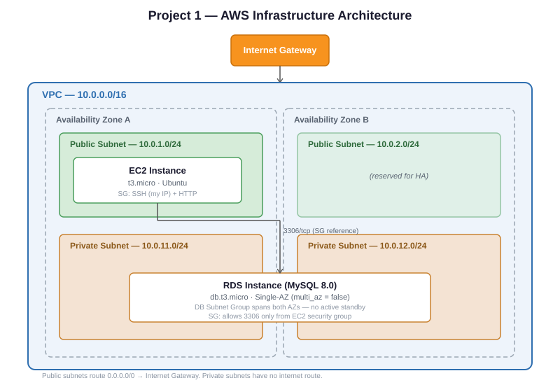

# Terraform AWS Infrastructure — Project 1

A foundational AWS environment built with Terraform: custom VPC with public/private
subnets, an EC2 instance, and a private RDS MySQL database — verified end-to-end
connectivity between EC2 and RDS.

## Architecture Diagram



## Architecture

- **VPC** (10.0.0.0/16) spanning 2 Availability Zones
- **2 public subnets** — house the EC2 instance, route to the internet via an Internet Gateway
- **2 private subnets** — house the RDS instance, no internet route (not publicly reachable)
- **EC2 instance** (t3.micro, Ubuntu) — SSH access restricted to a single IP via security group
- **RDS instance** (db.t3.micro, MySQL 8.0, Single-AZ) — only reachable from the EC2 security
  group, not from the internet or any CIDR range. DB subnet group spans both AZs, but
  `multi_az = false` — no active standby, chosen deliberately for free-tier compliance.

## Key design decisions

- RDS security group references the EC2 security group directly (not an IP range) —
  access is scoped to "traffic from EC2," independent of subnet or IP changes
- All resources chosen to stay within AWS free tier (t3.micro, gp2 storage, Single-AZ,
  20GB allocated storage)
- SSH access IP and DB password are both parameterized as variables (not hardcoded) and
  supplied via a local, gitignored `terraform.tfvars`
- `.tfstate` and `.tfvars` excluded from version control

## Cost

Verified $0 actual cost via AWS Cost Explorer across the full build/test/teardown
cycle. All resources selected for free-tier eligibility: `t3.micro` EC2, `db.t3.micro`
RDS (Single-AZ, `gp2` storage, 20GB), and networking components (VPC, subnets, IGW,
route tables) which carry no cost regardless of tier.

## Prerequisites

- Terraform >= 1.x
- AWS CLI configured (`aws configure`)
- An SSH key pair generated locally

## How to run

```bash
terraform init
terraform plan
terraform apply
```

## How to test

```bash
ssh -i <path-to-key> ubuntu@<ec2_public_ip>
mysql -h <rds_endpoint> -u admin -p
```

## Cleanup

```bash
terraform destroy
```

## File structure

| File                          | Contains                                          |
| ----------------------------- | ------------------------------------------------- |
| `terraform.tf`                | Provider configuration                            |
| `main.tf`                     | VPC, subnets, IGW, route tables                   |
| `security_groups.tf`          | EC2 security group                                |
| `keypair.tf`                  | SSH key pair                                      |
| `compute.tf`                  | EC2 instance, AMI data source                     |
| `database.tf`                 | RDS instance, DB subnet group, RDS security group |
| `variables.tf` / `outputs.tf` | Input variables and output values                 |

## Configuration

Create a `terraform.tfvars` file (not committed) with:

```hcl
db_password = "your-password-here"
my_ip       = "your-public-ip/32"
```
